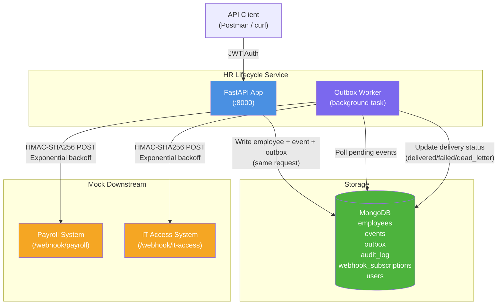

# HR Lifecycle Integration Service

A production-style integration service that manages employee records and **Joiner/Mover/Leaver (JML)** workflows, syncing changes to downstream systems (payroll, IT access) via an **event-driven transactional outbox pattern**.

> Simulates how an HR tech team integrates systems like SAP SuccessFactors with other enterprise platforms.

---

## Architecture Diagram



---

## Features

- **JML Workflows**: Joiner (create), Mover (update), Leaver (terminate) with validated state transitions
- **Transactional Outbox Pattern**: every employee change atomically writes an outbox event
- **HMAC-SHA256 Webhook Signing**: cryptographically signed payloads for all downstream calls
- **Exponential Backoff Retries**: up to 5 retries, then dead-letter with manual retry API
- **JWT Role-Based Access Control**: `hr_admin`, `hr_viewer`, `integration_admin`
- **Immutable Audit Trail**: who changed what, when, with before/after diffs
- **Idempotent Event Delivery**: per-(event, subscription) idempotency keys
- **Correlation IDs**: propagated through every request and log entry
- **90%+ Test Coverage**: unit + integration tests with mongomock-motor

---

## Quick Start (Docker Compose)

```bash
# Clone and start
git clone <repo>
cd hr-lifecycle-integration
cp .env.example .env

# Start all services (API, worker, mock downstream, MongoDB)
docker-compose up --build

# In another terminal, run the seed script
docker-compose exec api python -m scripts.seed

# Run the full JML demo
bash scripts/demo.sh
```

Services:
| Service | URL |
|---------|-----|
| HR API | http://localhost:8000 |
| API Docs (Swagger) | http://localhost:8000/docs |
| Mock Downstream | http://localhost:9000 |
| MongoDB | mongodb://localhost:27017 |

---

## Default Credentials (after seeding)

| Username | Password | Role |
|----------|----------|------|
| `hr_admin` | `HrAdmin123!` | Full access |
| `hr_viewer` | `HrViewer123!` | Read-only |
| `integration_admin` | `IntAdmin123!` | Events/outbox/retry |

---

## Example curl Calls

### 1. Authenticate

```bash
TOKEN=$(curl -s -X POST http://localhost:8000/api/v1/auth/token \
  -H "Content-Type: application/json" \
  -d '{"username":"hr_admin","password":"HrAdmin123!"}' | jq -r '.access_token')
```

### 2. Create Employee (Joiner)

```bash
curl -X POST http://localhost:8000/api/v1/employees \
  -H "Authorization: Bearer $TOKEN" \
  -H "Content-Type: application/json" \
  -d '{
    "employee_id": "EMP9999",
    "name": "Jane Doe",
    "email": "jane.doe@example.com",
    "department": "Engineering",
    "job_title": "Senior Engineer",
    "location": "London",
    "start_date": "2024-06-01"
  }'
```

### 3. Activate Employee

```bash
curl -X POST http://localhost:8000/api/v1/employees/EMP9999/activate \
  -H "Authorization: Bearer $TOKEN"
```

### 4. Move Employee

```bash
curl -X PATCH http://localhost:8000/api/v1/employees/EMP9999 \
  -H "Authorization: Bearer $TOKEN" \
  -H "Content-Type: application/json" \
  -d '{"department": "Product", "job_title": "Product Manager"}'
```

### 5. Terminate Employee (Leaver)

```bash
curl -X POST http://localhost:8000/api/v1/employees/EMP9999/terminate \
  -H "Authorization: Bearer $TOKEN" \
  -H "Content-Type: application/json" \
  -d '{"end_date": "2024-12-31"}'
```

### 6. View Audit Trail

```bash
INT_TOKEN=$(curl -s -X POST http://localhost:8000/api/v1/auth/token \
  -d '{"username":"integration_admin","password":"IntAdmin123!"}' \
  -H "Content-Type: application/json" | jq -r '.access_token')

curl http://localhost:8000/api/v1/admin/audit?employee_id=EMP9999 \
  -H "Authorization: Bearer $TOKEN"
```

### 7. Retry Dead-Lettered Events

```bash
curl -X POST http://localhost:8000/api/v1/admin/outbox/retry-all-dead-letters \
  -H "Authorization: Bearer $INT_TOKEN"
```

---

## Environment Variables

See [CONFIGURATION.md](docs/CONFIGURATION.md) for all settings.

---

## Running Tests

```bash
# Install dependencies
pip install -r requirements-dev.txt

# Run all tests with coverage
pytest --cov=app --cov-report=term-missing

# Run with verbose output
pytest -v

# Run only unit tests
pytest tests/unit/

# Run only integration tests
pytest tests/integration/

# Lint check
ruff check .
```

---

## Project Structure

```
hr-lifecycle-integration/
├── app/
│   ├── main.py              # FastAPI app, lifespan, middleware
│   ├── config.py            # Pydantic settings
│   ├── db.py                # MongoDB connection + indexes
│   ├── models/              # Pydantic models (employee, event, outbox, audit, user)
│   ├── routers/             # API route handlers (auth, employees, events, admin)
│   ├── services/            # Business logic (employee, jml, outbox, audit)
│   ├── workers/             # Outbox background worker
│   └── security/            # JWT auth, RBAC, HMAC signing
├── mock_downstream/         # Simulated payroll + IT access systems
├── tests/
│   ├── unit/                # State transition, auth, backoff, model tests
│   └── integration/         # Full JML, audit, outbox, auth integration tests
├── docs/                    # Architecture, API, RUNBOOK, CONFIGURATION docs
├── scripts/
│   ├── seed.py              # Idempotent synthetic data seed
│   └── demo.sh              # Full JML demo script
├── postman/collection.json  # Importable Postman collection
├── docker-compose.yml
├── Dockerfile
├── pyproject.toml           # pytest + ruff config
├── requirements.txt
└── requirements-dev.txt
```

---

## Documentation

| Document | Description |
|----------|-------------|
| [ARCHITECTURE.md](docs/ARCHITECTURE.md) | System design, data flow, outbox pattern |
| [API.md](docs/API.md) | Complete API reference |
| [CONFIGURATION.md](docs/CONFIGURATION.md) | All environment variables |
| [RUNBOOK.md](docs/RUNBOOK.md) | Troubleshooting guide |
| [OpenAPI (live)](http://localhost:8000/docs) | Auto-generated Swagger UI |

---

## Known Limitations

- The outbox worker runs as an `asyncio.Task` within the API process. For high-throughput production use, it should be extracted as a separate Celery/Redis-backed worker process.
- MongoDB is used without transactions (no replica set required for dev). For true atomicity, enable replica set and use `ClientSession` multi-document transactions.
- The mock downstream uses in-memory storage for received events (resets on restart).
