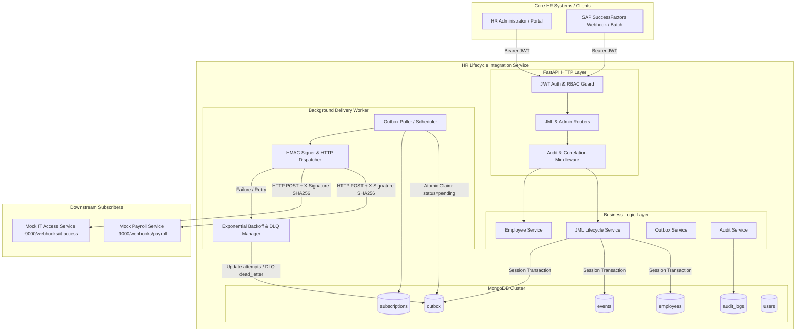
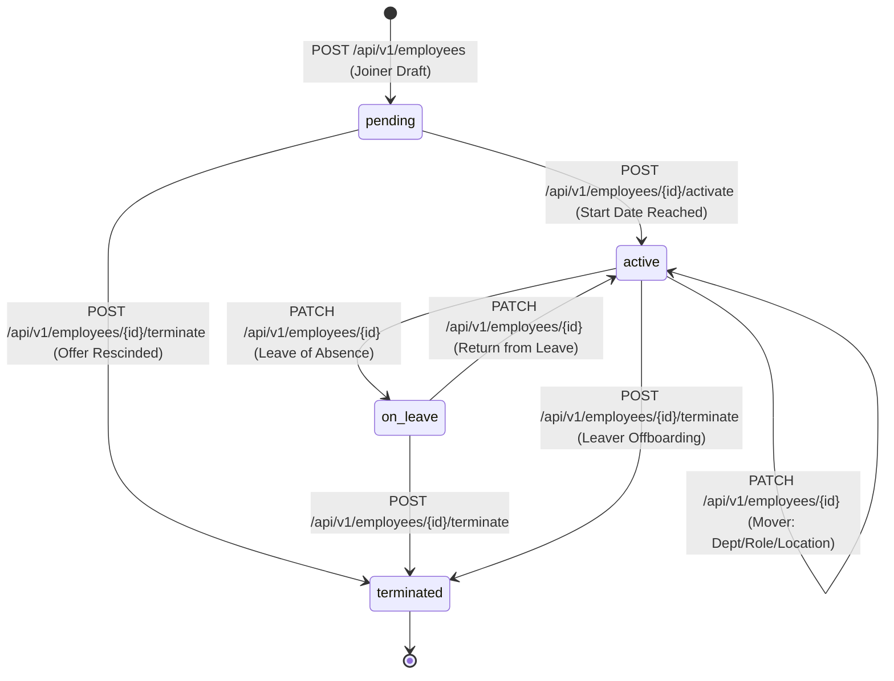
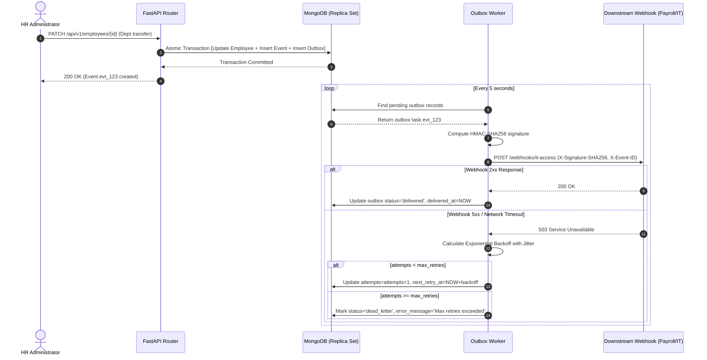

# Architecture & Design Specification

## Overview

The **HR Lifecycle Integration Service** is an enterprise-grade middleware component designed to bridge Core HR Information Systems (such as SAP SuccessFactors, Workday, or BambooHR) with downstream operational platforms (Payroll, Active Directory / Okta IT access management, ERPs, and compliance archives).

The platform coordinates **Joiner, Mover, and Leaver (JML)** lifecycle events, ensuring zero-loss, tamper-proof, and ordered synchronization via the **Transactional Outbox Pattern** and **HMAC-SHA256 authenticated webhooks**.

---

## 1. System Architecture



---

## 2. Joiner / Mover / Leaver (JML) Lifecycle State Machine

Employee lifecycle transitions adhere to a strict finite state machine (FSM). Unauthorized or invalid transitions (e.g. activating a terminated employee without re-hiring) are rejected with HTTP 400 validation errors.



### Event Specifications & Payloads

| Workflow | Event Type | Description | Key Payload Elements |
| :--- | :--- | :--- | :--- |
| **Joiner** | `employee.joined` | Emitted when an employee reaches active employment status. | `employee_id`, `name`, `email`, `department`, `job_title`, `start_date` |
| **Mover** | `employee.moved` | Emitted when department, title, manager, location, or compensation changes. | `employee_id`, `diff` (with before & after values for each modified field) |
| **Leaver** | `employee.left` | Emitted when employment is terminated, triggering payroll finalization and access revocation. | `employee_id`, `end_date`, `reason`, `department` |

#### Mover Diff Structure
When updating an employee, the system calculates a deep diff between the existing record and the new state:
```json
{
  "event_id": "evt_99f381c828d1",
  "event_type": "employee.moved",
  "timestamp": "2026-10-21T10:00:00Z",
  "data": {
    "employee_id": "EMP-00104",
    "diff": {
      "department": { "before": "Engineering", "after": "Product" },
      "job_title": { "before": "Software Engineer", "after": "Technical Product Manager" },
      "location": { "before": "London", "after": "Remote UK" }
    }
  }
}
```

---

## 3. Transactional Outbox Pattern

### The Dual-Write Problem
When an HR system updates a database record and directly invokes an external webhook over HTTP, failures (network dropouts, target downtime, service restarts) cause **dual-write inconsistency**:
- If DB commits but webhook fails: Downstream system never receives the event.
- If webhook succeeds but DB commit fails: Downstream system acts on phantom data.

### The Outbox Solution
In this service:
1. **Atomic Ingestion**: The state change in `employees`, the immutable audit record in `events`, and the delivery job in `outbox` are committed together in a single transactional operation.
2. **Asynchronous Dispatch**: The background outbox worker queries unprocessed records (`status="pending"`), selects active subscriptions for the event type, and delivers payloads with guaranteed at-least-once semantics.
3. **Optimistic Locking**: When polling, outbox records are locked by worker instances to prevent double processing in multi-instance clusters.



### Idempotency & Delivery Guarantees
- **At-Least-Once Delivery**: Events will be delivered until acknowledged by HTTP 2xx or routed to the DLQ.
- **Consumer Idempotency**: Each payload carries a unique `X-Event-ID` header and payload `event_id`. Downstream consumers store processed event IDs to safely ignore duplicates.
- **HMAC Signature**: The `X-Signature-SHA256` header is generated using HMAC-SHA256 over the raw JSON payload with the shared secret `WEBHOOK_HMAC_SECRET`.

---

## 4. Exponential Backoff & Dead-Letter Queue (DLQ)

When downstream webhooks experience transient failures, the worker calculates retry delays using exponential backoff with randomized jitter to prevent the "thundering herd" effect:

$$\text{backoff} = \min\left(\text{outbox\_backoff\_max\_seconds},\ \text{outbox\_backoff\_base\_seconds} \times 2^{\text{attempt}} + \text{jitter}\right)$$

Where:
- `outbox_backoff_base_seconds` = 2s
- `outbox_backoff_max_seconds` = 60s
- `outbox_max_retries` = 5

### Dead-Letter Queue State Machine
Once attempts reach 5, the outbox record transitions to `dead_letter`.
- Alerts are raised for operators.
- Administrators can review payload errors via `GET /api/v1/admin/outbox?status=dead_letter`.
- Upon fixing downstream issues, operators trigger manual replay via `POST /api/v1/admin/outbox/{id}/retry`, resetting retry counts and scheduling immediate re-delivery.

---

## 5. Security & RBAC Model

The service implements stateless OAuth2 Password flow with JSON Web Tokens (JWT) and Role-Based Access Control (RBAC).

### Roles & Permissions Matrix

| Resource & Operation | HR Admin | HR Operator | Viewer | Downstream Service |
| :--- | :---: | :---: | :---: | :---: |
| **User Management** | :white_check_mark: | :x: | :x: | :x: |
| **Manage Subscriptions** | :white_check_mark: | :x: | :x: | :x: |
| **Manage Outbox / DLQ Retry** | :white_check_mark: | :white_check_mark: | :x: | :x: |
| **Create Employee (Joiner)** | :white_check_mark: | :white_check_mark: | :x: | :x: |
| **Activate Employee** | :white_check_mark: | :white_check_mark: | :x: | :x: |
| **Update Employee (Mover)** | :white_check_mark: | :white_check_mark: | :x: | :x: |
| **Terminate Employee (Leaver)**| :white_check_mark: | :white_check_mark: | :x: | :x: |
| **Read Employees & Events** | :white_check_mark: | :white_check_mark: | :white_check_mark: | :white_check_mark: |
| **Read Audit Logs** | :white_check_mark: | :x: | :x: | :x: |

---

## 6. Data Models & Schemas

### Employee Entity (`employees`)
```json
{
  "_id": "ObjectId",
  "employee_id": "EMP-00042",
  "first_name": "Eleanor",
  "last_name": "Vance",
  "email": "eleanor.vance@company.com",
  "department": "Engineering",
  "job_title": "Staff Platform Engineer",
  "manager_id": "EMP-00010",
  "location": "San Francisco, CA",
  "employment_status": "active",
  "start_date": "2026-01-15T00:00:00Z",
  "end_date": null,
  "created_at": "2026-01-10T12:00:00Z",
  "updated_at": "2026-01-15T09:30:00Z"
}
```

### Outbox Record (`outbox`)
```json
{
  "_id": "ObjectId",
  "outbox_id": "out_6b34f71a09",
  "event_id": "evt_99f381c828d1",
  "event_type": "employee.joined",
  "payload": { ... },
  "subscription_id": "sub_payroll_01",
  "target_url": "http://mock_downstream:9000/webhooks/payroll",
  "status": "pending",
  "attempts": 0,
  "max_attempts": 5,
  "next_retry_at": "2026-10-21T10:00:00Z",
  "delivered_at": null,
  "last_error": null,
  "created_at": "2026-10-21T10:00:00Z"
}
```

### Audit Log (`audit_logs`)
Every state mutation creates an immutable audit record logging actor identity, role, IP address, correlation ID, before/after snapshot, and action name.
